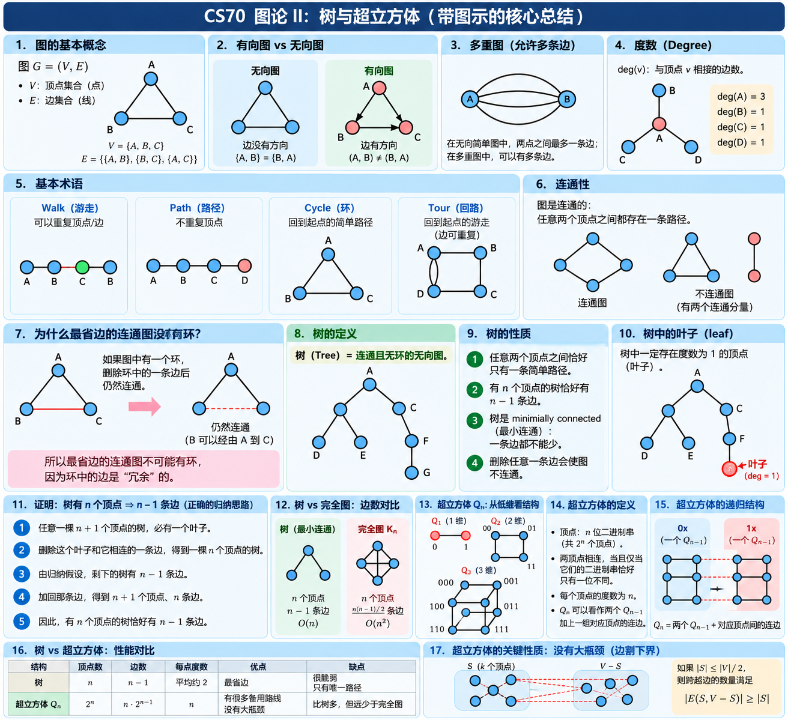

# CS70 图论 II：树与超立方体

这一讲其实只有两条主线：

\[ \boxed{\text{连通最省边} \Rightarrow \text{树}} \]

\[ \boxed{\text{既想连通又想抗故障} \Rightarrow \text{超立方体}} \]

上一讲的欧拉回路研究“能不能把所有边一次走完”；这一讲换了一个问题：

> **为了让图保持连通，我们到底要付出多少条边？如果还要求可靠、不堵塞，又该怎么设计？**

课程明确说这一阶段讨论图时，核心主题就是 connectivity。   

------

## 一、为什么最省边的连通图不能有环？

想象顶点是城市，边是高速公路。

目标：

\[ \boxed{\text{所有城市互通，同时公路尽可能少}} \]

假设图里有一个环：

```
      A
     / \
    B---C
```

如果删掉边 \(BC\)：

```
      A
     / \
    B   C
```

\(B\) 和 \(C\) 仍然可以：

\[ B\to A\to C \]

所以图还是连通的。

这就是环最关键的性质：

> **环意味着“有备用路线”。**

因此环中的任意一条边至少在“维持连通”这件事上是多余的。

于是：

\[ \boxed{\text{最省边的连通图不可能含环}} \]

课堂就是从“若存在 cycle，则删掉其中一条边仍保持 connected”得到这个结论。   

------

# 二、Tree：树

于是自然得到定义：

\[ \boxed{\text{Tree}=\text{Connected}+\text{Acyclic}} \]

即：

> **树 = 连通且无环的无向图。**

图形上大概是：

```
          A
        /   \
       B     C
      / \     \
     D   E     F
              |
              G
```

它连通，但任何地方都没有闭环。

课堂正式把 connected + acyclic 的图定义为 tree。   

------

## 三、树为什么叫“最小连通”？

树有个非常强的特点：

> 任意两个顶点之间恰好只有一条简单路径。

例如：

```
A —— B —— C —— D
         |
         E
```

从 \(A\) 到 \(E\)：

\[ A\to B\to C\to E \]

只有这一条。

为什么不能有两条？

如果有两条不同路径：

```
     ·────·
    /      \
   u        v
    \      /
     ·────·
```

两条路径合起来就会形成环。

这和“树无环”矛盾。

所以：

\[ \boxed{\text{树中任意两点之间恰好一条路径}} \]

这也说明树很脆弱：

```
A —— B —— C —— D
```

如果删掉 \(BC\)：

```
A —— B      C —— D
```

直接断成两块。

所以树是：

\[ \boxed{\text{minimally connected，最小连通}} \]

课堂随后正是用这个特点引出可靠性问题。  

------

# 四、树到底需要多少条边？

核心定理：

\[ \boxed{\text{有 }n\text{ 个顶点的树恰好有 }n-1\text{ 条边}} \]

这个结论其实极其直观。

看树逐渐长大：

```
1 个点：

●
0 条边
```

增加一个点：

```
●——●
```

变成：

\[ 2\text{ 个点},\quad1\text{ 条边} \]

再增加一个：

```
●——●——●
```

变成：

\[ 3\text{ 个点},\quad2\text{ 条边} \]

再加：

```
    ●
    |
●——●——●
```

变成：

\[ 4\text{ 个点},\quad3\text{ 条边} \]

所以看起来：

\[ |E|=|V|-1 \]

课堂明确要证明 connected + acyclic 等价于 connected + \(n-1\) edges。 

但这里藏着一个非常重要的归纳陷阱。

------

# 五、一个看起来完美、实际上错误的归纳证明

很容易这么想：

> 已知一个 \(n\) 个顶点的树有 \(n-1\) 条边。
>
> 我加一个新顶点，再连一条边：
>
> \[ n+1\text{ 个点},\quad n\text{ 条边} \]
>
> 所以证完。

图上就是：

```
原来的树 T_n：

●——●
   / \
  ●   ●
```

然后：

```
加一个点：

●——●
   / \
  ●   ●——○
```

好像完全正确。

但这不是合法归纳证明。

为什么？

因为你只证明了：

> **我可以构造一种 \(n+1\) 个顶点的树。**

而你真正要证明的是：

> **任意一个 \(n+1\) 个顶点的树都有 \(n\) 条边。**

这两件事完全不同。

课堂把这个错误专门叫：

\[ \boxed{\text{build-up error}} \]

------

## 六、归纳步骤正确的思维方向

这是这一讲非常重要的归纳法经验：

错误思路：

\[ \boxed{n\text{ 的对象}\rightarrow\text{我自己造一个 }n+1\text{ 的对象}} \]

正确思路：

\[ \boxed{\text{先拿一个任意的 }n+1\text{ 对象} \rightarrow \text{从里面找到一个 }n\text{ 对象}} \]

你要证明的是“所有 \(n+1\) 情况”，所以必须从：

> 任意一个 \(n+1\) 情况

开始。

课堂对此说得很直接：归纳步骤不是问“如何从 \(n\) 搭出 \(n+1\)”，而是拿任意 \(n+1\) 对象，在里面找到可以应用归纳假设的 \(n\) 对象。  

这个记忆点非常重要：

\[ \boxed{\text{归纳证明常常是“大对象拆成小对象”，不是“小对象随便搭成大对象”。}} \]

------

# 七、那么树怎么拆？

拿一个任意的树：

```
          A
        /   \
       B     C
      /     / \
     D     E   F
              |
              G
```

我们希望找到一个“尾巴”：

```
          A
        /   \
       B     C
      /     / \
     D     E   F
              |
             [G]
```

\(G\) 只连接一条边：

\[ \deg(G)=1 \]

这种点叫：

\[ \boxed{\text{leaf，叶子}} \]

如果删除叶子 \(G\) 和唯一连接它的边：

```
          A
        /   \
       B     C
      /     / \
     D     E   F
```

剩下的仍然：

- 连通；
- 无环。

所以仍然是一棵树。

这样：

\[ n+1\text{ 个顶点的树} \]

真正变成：

\[ n\text{ 个顶点的树} \]

归纳假设终于能用了。

------

# 八、为什么一棵有限树一定存在叶子？

这是刚才整个归纳证明缺失的关键 lemma。

随便从一个顶点开始，一直沿着没走过的新顶点往前走：

```
A → B → C → D → ...
```

因为图没有环，你不可能回到以前经过的点。

因为图是有限的，你也不可能永远走。

所以最终一定停在某个点：

```
A —— B —— C —— D
                   ↑
                  停了
```

为什么会停？

因为 \(D\) 已经没有其他可以继续走的新边。

所以 \(D\) 只能通过刚才来的那条边和图相连：

\[ \deg(D)=1 \]

它就是叶子。

课堂用的直觉正是：

> 无环意味着一路走时不会看到同一个地方两次；图又有限，所以必然最终走到一个“伸出来的尾巴”。  

------

# 九、于是 \(n-1\) 条边的证明变得极短

设命题：

\[ P(n):\quad n\text{ 个顶点的树有 }n-1\text{ 条边} \]

假设 \(P(n)\) 成立。

现在取**任意一棵** \(n+1\) 个顶点的树。

它必有叶子：

```
大树
│
└────○  ← leaf
```

删掉：

- 一个 leaf；
- 与 leaf 相连的一条边。

得到一棵 \(n\) 个顶点的树。

归纳假设：

\[ |E|=n-1 \]

现在把刚才删掉的边加回来：

\[ (n-1)+1=n \]

所以 \(n+1\) 个顶点有：

\[ n=(n+1)-1 \]

条边。

完成。

课堂最终的正确证明就是“找叶子 → 删除一个点和一条边 → 对剩余树使用归纳假设”。 

------

# 十、树定理的另一个方向

课程还要证明：

\[ \boxed{ \text{connected}+\text{acyclic} \iff \text{connected}+n-1\text{ edges} } \]

刚刚证明了：

\[ \text{connected + acyclic} \Rightarrow n-1\text{ edges} \]

反方向：

\[ \text{connected}+n-1\text{ edges} \Rightarrow \text{acyclic} \]

为什么？

假设反而存在环：

```
      ●
     / \
    ●---●
     \
      ...
```

那么可以删除环中的一条边，并且仍然连通：

```
      ●
     / \
    ●   ●
     \
      ...
```

于是得到：

\[ n\text{ 个顶点},\quad n-2\text{ 条边} \]

但课程接着证明：

\[ \boxed{ n\text{ 个顶点、}k\text{ 条边} \Rightarrow \text{至少有 }n-k\text{ 个连通分量} } \]

所以 \(k=n-2\) 时：

\[ n-k=2 \]

至少两个连通分量，不可能连通。

因此没有环。

------

# 十一、到这里得到一个非常漂亮的结论

对 \(n\) 个顶点：

```
边太少                    刚刚好                     边更多
< n-1                   n-1                      > n-1
  │                       │                         │
  ▼                       ▼                         ▼
无法连通                可以成为树                 可以有冗余
```

所以：

\[ \boxed{\text{让 }n\text{ 个顶点连通的最低边数就是 }n-1} \]

树就是这个极限状态：

\[ \boxed{\text{一条都不能少}} \]

------

# 十二、但是“最省”带来一个大问题：太脆

例如：

```
●——●——●——●——●
```

只断一条边：

```
●——●    ●——●——●
```

整个网络就分裂。

因此树虽然成本最低：

\[ O(N) \]

但：

\[ \boxed{\text{可靠性很差}} \]

同时也容易形成瓶颈。

例如：

```
左半边                     右半边

●──●                       ●──●
   \                       /
    ●───────────────●
          ↑
      所有流量都得走这里
```

中间一条边坏掉，网络分裂；流量太多，它又成为 bottleneck。

这正是课程从 trees 转向 hypercubes 的原因。   

------

# 十三、那直接每个人互相连不就行了吗？

当然可以。

这叫完全图：

\[ K_N \]

例如 \(K_4\)：

```
A────B
|\  /|
| \/ |
| /\ |
|/  \|
D────C
```

每个顶点都连接其他：

\[ N-1 \]

个顶点。

根据握手定理：

\[ \boxed{\sum_{v\in V}\deg(v)=2|E|} \]

所以：

\[ 2|E|=N(N-1) \]

即：

\[ |E|=\frac{N(N-1)}2 \]

大约是：

\[ \boxed{O(N^2)} \]

课堂在这里引入握手定理，并用它算完全图的边数。   

于是出现两个极端：

\[ \boxed{ \begin{array}{ccc} \text{树}&&\text{完全图}\\ O(N)&&O(N^2)\\ \text{便宜但脆弱}&&\text{可靠但太贵} \end{array}} \]

我们真正想要：

> 边没有 \(N^2\) 那么夸张，但又有大量备用路线。

这就引出了：

\[ \boxed{\text{Hypercube，超立方体}} \]

------

# 十四、超立方体从低维开始看最直观

记 \(Q_n\) 为 \(n\) 维超立方体。

### \(Q_1\)

两个点：

```
0 ───── 1
```

### \(Q_2\)

两个 \(Q_1\) 拼起来：

```
00 ───── 01
│         │
│         │
10 ───── 11
```

就是一个正方形。

### \(Q_3\)

两个 \(Q_2\) 拼起来：

```
      000────001
      /       /|
    010────011 |
     |       | |
     | 100───|-101
     | /     | /
    110────111
```

就是普通立方体。

课堂正是按 \(Q_1\to Q_2\to Q_3\to Q_4\) 这样递归构造。   

------

# 十五、\(Q_n\) 的真正定义：别试图想象四维

高维之后不要再靠空间想象。

每个顶点就是一个：

\[ n\text{ 位二进制串} \]

例如 \(Q_4\)：

\[ 0000,\ 0001,\ 0010,\ldots,1111 \]

因此顶点数：

\[ \boxed{|V|=2^n} \]

两个顶点什么时候连边？

> 它们的二进制串恰好只有一位不同。

例如：

\[ 101100 \]

有邻居：

\[ 001100 \]\[ 111100 \]\[ 100100 \]\[ 101000 \]\[ 101110 \]\[ 101101 \]

每次只翻一位 bit。

因此 \(Q_n\) 中每个顶点：

\[ \boxed{\deg(v)=n} \]

课堂就是这样定义超立方体的顶点和邻接关系。   

------

# 十六、超立方体的递归结构

这其实比二进制定义还重要。

\(Q_n\) 可以看成两个：

\[ Q_{n-1} \]

其中左边所有顶点前面加 \(0\)，右边加 \(1\)：

```
        0x                    1x

     Q_{n-1}               Q_{n-1}

       ●────────────────────●
       ●────────────────────●
       ●────────────────────●
       ●────────────────────●
```

每个：

\[ 0x \]

都与对应：

\[ 1x \]

连边。

所以：

\[ \boxed{ Q_n= \text{两个 }Q_{n-1} + \text{对应顶点间的一组边} } \]

课堂明确指出这是超立方体的递归定义。   

这个结构也是后面归纳证明的核心。

------

# 十七、超立方体为什么比树可靠？

树可能这样：

```
██████ —— ██████
           ↑
         一条边
```

把一大块 \(S\) 和另一大块 \(V-S\) 分开，可能只需要切：

\[ 1 \]

条边。

超立方体不一样。

想把顶点集合切成：

```
       S        |       V-S
                |
```

假设：

\[ |S|\le\frac{|V|}{2} \]

课堂要证明的关键性质是：

\[ \boxed{ |E(S,V-S)|\ge |S| } \]

其中：

\[ E(S,V-S) \]

表示一端在 \(S\)，另一端在 \(V-S\) 的边。

也就是说：

> 想把 \(k\) 个顶点从整个超立方体里割出去，至少得切掉 \(k\) 条边。

这就是所谓：

\[ \boxed{\text{没有严重 bottleneck}} \]

------

# 十八、用图看这个结论

假设一个网络：

```
       S                    V-S

   ●──●──●           ●──●──●
   │  │  │           │  │  │
   ●──●──● ─ ─ ─ ─ ─ ●──●──●
               ↑
             只有 1 条
```

如果左边有 1000 个处理器，却只有一条线通往右边，那么无论内部连接多好：

\[ \boxed{\text{这一条线就是巨大瓶颈}} \]

而超立方体希望做到：

```
       S                    V-S

   ●──●──● ───────── ●──●──●
   │  │  │ ───────── │  │  │
   ●──●──● ───────── ●──●──●
```

被割出去的集合越大：

\[ |S|\uparrow \]

跨出去的线路也必须跟着多：

\[ |E(S,V-S)|\uparrow \]

所以不存在：

> 一大坨机器只能通过一根线与外界通信。

------

# 十九、课堂这里故意展示了第二个“错误归纳证明”

课程试图利用：

\[ Q_{n+1}=Q_n+Q_n+\text{横向边} \]

来归纳证明 cut 的下界。

于是把：

\[ S \]

拆成：

\[ S_0,\quad S_1 \]

分别落在两个 \(Q_n\) 里面：

```
      Q_n                    Q_n

   ┌────────┐            ┌────────┐
   │  S_0   │============│  S_1   │
   │        │============│        │
   └────────┘            └────────┘
```

第一反应是：

\[ |E(S_0,V_0-S_0)|\ge |S_0| \]

以及：

\[ |E(S_1,V_1-S_1)|\ge |S_1| \]

加起来：

\[ \ge |S_0|+|S_1|=|S| \]

看起来秒证。

然后老师马上说：

> **这个证明完全错了。**

------

# 二十、错在哪里？

最关键的问题是：

原命题使用归纳假设有前提：

\[ |S_i|\le\frac{|V_i|}{2} \]

但整体只知道：

\[ |S|\le\frac{|V|}{2} \]

并不意味着：

\[ |S_0|\le\frac{|V_0|}{2} \]

和：

\[ |S_1|\le\frac{|V_1|}{2} \]

都成立。

例如：

```
左半个 Q_n             右半个 Q_n

██████████              ██
██████████
██████████

S_0 超过一半            S_1 很小
```

整体的 \(S\) 仍然可能不到整个 \(Q_{n+1}\) 的一半。

但左侧：

\[ S_0 \]

已经超过左边 \(Q_n\) 的一半。

于是你根本**没有资格**直接对 \(S_0\) 套归纳假设。

这就是这个证明真正的问题。

课堂从另一个角度指出：那个错误推导实际上没有利用两个子超立方体之间 \(0x\leftrightarrow1x\) 的横向边，因此甚至像在对一个没有这些边的图证明同样结论，这是明显的警报。   

本讲到这里没有在视频中完整展开正确证明，而是明确让学生看讲义中的证明。   

所以这一部分不要硬背那个错误 induction。

------

# 二十一、这一讲真正要学的三个证明技巧

### 1. 环 = 冗余

```
A
|\ 
| \
B──C
```

环里删一条边还有另一条路。

因此：

\[ \boxed{\text{最小连通结构必无环}} \]

------

### 2. 归纳不要犯 build-up error

不要：

```
一个 n 对象
   ↓
我自己随便添东西
   ↓
得到某个 n+1 对象
```

而应该：

```
任意 n+1 对象
   ↓
寻找可安全删除的结构
   ↓
得到 n 对象
   ↓
使用归纳假设
```

树里那个“可安全删除的结构”就是：

\[ \boxed{\text{leaf}} \]

------

### 3. 递归定义的结构天然适合归纳

超立方体：

\[ Q_n= Q_{n-1}+Q_{n-1}+\text{matching edges} \]

图本身就是递归生成的。

所以要证明 \(Q_n\) 的性质，第一反应自然是：

\[ \boxed{\text{对维度 }n\text{ 做归纳}} \]

但每次套归纳假设前必须检查：

> **小问题是否真的满足归纳命题的全部前提？**

这正是课堂故意给错误证明的意义。

------

# 二十二、整讲压缩成一张图

```
                连通性需要多少成本？
                         │
             ┌───────────┴───────────┐
             │                       │
         尽可能省边              想提高可靠性
             │                       │
     有环就能删掉一条边          树太脆弱
             │                       │
       连通 + 无环                 完全图？
             │                       │
            Tree                O(N²) 太贵
             │                       │
       n 个点 n-1 条边               │
             │                       ▼
       最小连通结构              Hypercube
             │                       │
         只有唯一路径          N = 2^n 个点
             │                 每点度数 n
         故障容易断网                │
                                     ▼
                             Q_n = 两个 Q_{n-1}
                                     │
                                     ▼
                           大集合不能靠少数边
                              与外界连接
                                     │
                                     ▼
                               没有大瓶颈
```

------

## 最后只记 5 句话

\[ \boxed{\text{树 = 连通 + 无环}} \]

\[ \boxed{\text{树有 }n\text{ 个顶点}\Rightarrow n-1\text{ 条边}} \]

\[ \boxed{\text{树是最省边的连通图，但代价是极其脆弱}} \]

\[ \boxed{Q_n\text{ 的顶点是 }n\text{ 位 bit string，相差一位就连边}} \]

\[ \boxed{\text{超立方体用 }O(N\log N)\text{ 级别的边，在成本与可靠性之间取折中}} \]

其中最后一句的 \(O(N\log N)\) 可直接由本讲给出的 \(N=2^n\)、每个顶点度数为 \(n\)，再结合握手定理推出；这是对课堂定义的直接推论。   

这讲最值得真正吃透的不是公式，而是这两个图像：

```
树：     一条都不能少
         ●──●──●──●

超立方体：有很多备用路线，但又没有完全图那么贵
         □──□
         │╲ │
         □──□
```

也就是：

\[ \boxed{\text{Tree = 最小连通}} \qquad\text{vs.}\qquad \boxed{\text{Hypercube = 廉价但高冗余的连通}} \]


