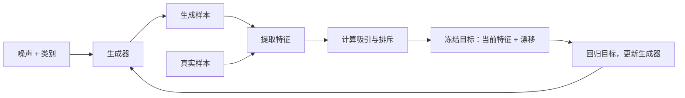

> 来源说明：本文为 AI 辅助论文解读，文中的“我”沿用原回答语境，不代表仓库作者独立完成了全部推导与判断。后续的真实学习问题见[追问附录](./附录/drifting-follow-ups.md)。

这篇是 **《Generative Modeling via Drifting》**，作者是 Mingyang Deng、He Li、Tianhong Li、Yilun Du 和 Kaiming He。

先用大白话说：**网络先生成一批样本，再根据真实样本和生成样本的相对位置，算出每个样本应该往哪里挪；训练网络，让它下次直接生成挪动后的结果。训练结束后，从噪声到图像只需一次生成器前向计算。**

我读的是 **2026 年 2 月 6 日的 v2，共 28 页，包含附录 A–C**，并核对了主要实验表格。论文来源：[arXiv v2 PDF](https://arxiv.org/pdf/2602.04770v2)

我的判断是：**它最有价值的贡献，是把一种直接由样本间相互作用构造的训练信号，做成了高质量的一步生成系统。实验很强，但“漂移趋近于零就意味着分布学对了”，仍然需要仔细限定。**下面按你给的 12 个环节展开；论文结论、我的推断和研究提议会分别说明。

------

**1. 研究问题与重要性**

假设我们想训练一个生成猫图片的模型。理想情况是：输入不同随机噪声，直接输出不同的猫，而且这些猫的姿态、毛色、背景分布都接近真实数据。

Diffusion 和常规 Flow Matching 通常把这件事拆成许多小步骤：先生成噪声，再逐步修改，直到成为图像。每一步都要运行网络，推理成本随步数增加。

这篇论文问的是：

> 能否直接训练一个噪声到数据的映射，不依赖多步生成教师，也不要求学习一条噪声到数据的时间轨迹，同时达到很好的生成质量？

这个问题的价值很直接：图片生成可以降低延迟；机器人策略可以更快生成动作序列。尤其在控制场景里，每次决策都运行几十次网络，会挤占感知和反馈的时间预算。

这里需要区分两件事：**一步生成早就存在；论文研究的是一种新的、有效的一步生成训练方式。**GAN、经典 VAE 和早期 moment matching 网络都已有单次前向生成能力。

------

**2. 前人工作与不足**

可以把最相关的方法放在一起比较：

| 路线                                        | 已经能做到什么                          | 与本文相关的限制                                   |
| ------------------------------------------- | --------------------------------------- | -------------------------------------------------- |
| Diffusion / Flow Matching                   | 高质量、多样化生成                      | 常规采样需要多次网络计算                           |
| Diffusion distillation                      | 把多步教师压缩为一步或少步学生          | 通常需要先训练或获得强教师                         |
| Consistency、Shortcut、MeanFlow / iMeanFlow | 可以直接训练一步生成模型                | 训练目标仍与时间轨迹、跨时间映射或流的性质紧密相关 |
| GAN                                         | 直接一步生成高质量样本                  | 需要协调生成器和判别器的对抗优化                   |
| Generative Moment Matching Networks，GMMN   | 用 MMD 匹配真实和生成分布，无需对抗训练 | 高维空间中，核函数、特征和有限样本估计成为关键难点 |

其中，**GMMN 是理解本文 novelty 时不能跳过的前人工作**。2015 年的 GMMN 就已经提出：使用 MMD 训练一个前馈网络，单次前向产生样本，并结合 autoencoder 的表示空间改善效果。因此，“无判别器、一步生成、分布匹配”这几件事本身都不是本文首创。[GMMN 原论文](https://arxiv.org/abs/1502.02761)

还有一条值得补充的历史线索：**Amortized SVGD** 已经研究过，让神经采样器的输出沿着粒子更新方向移动。它与本文的共同点，是把样本空间的更新转化成网络参数训练；区别包括目标分布信息的获取方式，以及具体场的构造。SVGD 通常利用目标密度的梯度，本文直接利用真实样本。[Amortized SVGD](https://proceedings.mlr.press/r15/feng17a.html)

所以，我对贡献的定位是：

**本文提出了以 drifting field 为中心的训练框架，设计了归一化的吸引—排斥场，并通过特征空间、大批量样本和训练细节，把这条路线推进到了很强的 ImageNet 一步生成结果。**

“训练时演化分布”是有帮助的组织视角，但这个描述也适用于许多已有生成模型，不能单独充当新颖性的全部理由。

------

**3. 重建作者的思考路径**

以下是根据已有知识重建的研究思路，**不是作者公开记录的实际思考过程**。

首先，GAN 已经说明：一个网络直接从噪声生成复杂图像，在表达能力上是可行的。因此，多步推理并非所有高质量生成模型的必要条件。

接着，困难变成了监督信号。分类任务有明确标签；生成任务中，某个随机噪声却没有唯一对应的真实图像。随便给噪声配一张图片做回归，会产生不合理的配对约束。

一个自然想法是：不规定每个噪声对应谁，只看整批生成样本与真实样本哪里不同。MMD 等方法已经提供了这种分布级监督。

再往前想，可以直接给每个生成样本一个修改建议：附近真实数据多，就向那里靠近；附近生成样本太密，就向外分散。这样既照顾真实性，也照顾覆盖度。

最后，神经网络训练本来就在反复更新参数。既然如此，可以把这些修改建议用于训练：每更新一次网络，整批输出的分布就跟着移动。训练完成后，保留最终映射即可。

真正需要解决的技术问题是：**怎样构造修改建议，使正确分布能够保持不动，并且有限样本估计出来的方向足够有用？**

------

**4. 核心 Intuition**

真实样本告诉生成器哪些区域应该有概率质量，生成样本告诉它哪些区域已经被占据。每个生成样本受到真实样本的吸引，同时受到生成样本的排斥。把两种作用合起来，形成一个修正方向，再训练网络直接输出修正后的结果。理想情况下，当两个分布匹配时，吸引与排斥相互抵消。

这里的“排斥有助于避免堆在一起”是一种机制解释，**不等于已经证明模型不会 mode collapse**。

------

**5. 具体方法与完整 Pipeline**

以论文实际研究的 **ImageNet 类别条件生成**为例，假设指定类别是 bald eagle。

1. **准备条件与噪声。**
   输入随机噪声、类别标签，以及可选的 guidance 强度。latent 版本的高斯噪声形状是 \(32\times32\times4\)。
2. **生成一批当前样本。**
   DiT 风格的生成器一次前向，输出同样形状的 latent。此时得到的是当前模型生成的“白头海雕”样本，质量可能很差。
3. **准备正样本与负样本。**
   正样本来自该类别的真实训练数据；负样本主要来自这一批生成结果。这里的“负”只表示它承担排斥作用，不是人工标注的错误图像。
4. **把样本放进特征空间。**
   用预训练 encoder 提取多尺度、多位置特征，衡量哪些样本相近。latent 版本可以直接使用 latent-MAE 特征；pixel 版本直接生成 \(256\times256\times3\) 图像，再提取特征。
5. **计算漂移方向。**
   对每个生成特征，计算真实特征的加权中心与生成特征的加权中心，两者之差就是修正方向。距离越近，权重通常越大。
6. **构造冻结目标并回归。**
   把“当前特征＋漂移”当作本轮固定目标。梯度穿过特征提取器，更新生成器，使它下次输出更接近这个目标的样本。
7. **推理时只运行生成路径。**
   不再需要真实样本、负样本或训练用特征 encoder。latent 版本仍需 VAE decoder 把 latent 还原为图片，因此 **1-NFE 指生成器调用一次，不表示整个系统只运行一个网络模块**。

可以把训练关系压缩成：

````

````

实际系统比这个骨架更丰富：它组合多个温度，归一化特征与漂移，并使用样本队列。附录 A.5 还说明，特征损失之外保留了原始空间的 drifting loss。因此，不能把完整实现简化成“只匹配一个语义向量”。

------

**6. 核心数学推导**

先把符号固定下来：

- \(p\)：真实数据分布。
- \(\epsilon\sim p_\epsilon\)：随机噪声。
- \(x=f_\theta(\epsilon)\)：生成样本。
- \(q_\theta\)：生成样本形成的分布。
- \(V_{p,q}(x)\)：建议样本 \(x\) 移动的方向和幅度。

**从样本映射到分布映射**

论文写：

\[ q_\theta=(f_\theta)_\#p_\epsilon. \]

这里的 \(\#\) 叫 pushforward。意思很朴素：反复抽噪声、送入网络，所有输出形成一个分布。

训练的目标就是让：

\[ q_\theta\approx p. \]

网络参数每更新一次，输出分布也会变化。本文围绕这种训练期间的分布变化来构造监督。

**吸引与排斥怎么计算**

论文使用的基础核是：

\[ k_\tau(x,y)= \exp\left(-\frac{\|x-y\|_2}{\tau}\right). \]

注意这里是距离 \(\|x-y\|_2\)，没有平方。温度 \(\tau\) 控制作用范围：小温度更关注附近样本，大温度更容易把远处样本一起平均。

定义两个局部加权平均：

\[ \mu_p(x)= \frac{\mathbb E_{y\sim p}[k_\tau(x,y)y]} {\mathbb E_{y\sim p}[k_\tau(x,y)]}, \]

\[ \mu_q(x)= \frac{\mathbb E_{y\sim q}[k_\tau(x,y)y]} {\mathbb E_{y\sim q}[k_\tau(x,y)]}. \]

真实样本的吸引方向是 \(\mu_p(x)-x\)，生成样本的排斥方向是 \(-(\mu_q(x)-x)\)。相加后：

\[ \boxed{V_{p,q}(x)=\mu_p(x)-\mu_q(x).} \]

直观上，它比较的是：**在这个位置附近，真实数据的重心和当前生成数据的重心差在哪里。**

**反对称性究竟证明了什么**

交换真实分布与生成分布：

\[ V_{p,q}(x)=-V_{q,p}(x). \]

如果 \(p=q\)，则：

\[ V_{p,p}(x)=-V_{p,p}(x), \]

所以：

\[ \boxed{p=q\Longrightarrow V_{p,q}(x)=0.} \]

这就是正文 Proposition 3.1 的核心。

它保证的是：**正确答案是一个平衡点。**

它没有直接保证：平衡点只有这一个、这个平衡点稳定、网络一定会到达它。这三个问题都比上述等式更难。

**为什么必须有 stop-gradient**

令当前生成样本是 \(x=f_\theta(\epsilon)\)，构造：

\[ t=\operatorname{sg}\big(x+V_{p,q_\theta}(x)\big), \]

其中 \(\operatorname{sg}\) 表示 stop-gradient：数值照常计算，但反向传播时把整个目标视为常数。

损失为：

\[ \mathcal L(\theta)= \mathbb E_\epsilon \left[ \left\| f_\theta(\epsilon)- \operatorname{sg}\big(f_\theta(\epsilon)+V(f_\theta(\epsilon))\big) \right\|_2^2 \right]. \]

虽然其前向数值等于 \(\mathbb E\|V\|^2\)，梯度却不是直接对这个表达式求全导数。对于一个样本：

\[ \nabla_x\mathcal L=-2V(x). \]

如果 \(x\) 本身是可自由优化的变量，一步梯度下降就会使它沿 \(V\) 移动。

但实际优化的是网络参数。令：

\[ J_\theta(\epsilon)= \frac{\partial f_\theta(\epsilon)}{\partial\theta}, \]

则：

\[ \nabla_\theta\mathcal L = -2\mathbb E_\epsilon \left[J_\theta(\epsilon)^\top V(f_\theta(\epsilon))\right]. \]

这揭示了一个容易忽略的区别：**给每个样本指定方向，不代表共享参数的网络能够让每个样本独立照着走。**不同样本的梯度可能冲突，网络结构也可能限制可实现的变化。

所以，不能仅凭损失的前向形式，就声称训练严格、单调地减少了某个分布距离。

**特征空间版本**

把样本 \(x\) 换成特征 \(\phi(x)\)：

\[ \mathcal L_\phi= \mathbb E \left[ \left\| \phi(f_\theta(\epsilon))- \operatorname{sg}\left( \phi(f_\theta(\epsilon)) + V_{\phi_\#p,\phi_\#q} \big(\phi(f_\theta(\epsilon))\big) \right) \right\|_2^2 \right]. \]

encoder 的参数可以冻结，但梯度仍穿过它对输入的导数，传回生成器。

另一个细节是：附录还将漂移按其均方幅度归一化。**实际归一化后的训练 loss，不能直接当成原始漂移能量，更不能未经校准就解释成分布误差。**

**它与 MMD 的数学联系**

MMD 的平方可以写成：

\[ \operatorname{MMD}^2(p,q) = \mathbb E_{p,p}[k(y,y')] +\mathbb E_{q,q}[k(x,x')] -2\mathbb E_{p,q}[k(y,x)]. \]

第一项与生成器无关；后两项对生成样本求梯度，也会产生真实样本吸引、生成样本排斥的结构。

论文附录 C.2 明确承认这层联系。差异主要在于：本文直接设计 \(V\)，可以使用依赖分布的归一化、漂移幅度调整和 guidance 构造，不必先找一个固定的 MMD 标量目标再求梯度。

因此，**MMD 与 drifting 有实质联系，但论文的完整训练方案不能简单等同于标准 MMD。**

**CFG 的解释也有边界**

论文将负样本分布改成：

\[ \widetilde q=(1-\gamma)q_\theta(\cdot\mid c) +\gamma p_{\mathrm{uncond}}. \]

若形式上要求 \(\widetilde q=p(\cdot\mid c)\)，可解得：

\[ q_\theta(\cdot\mid c) = \alpha p(\cdot\mid c) -(\alpha-1)p_{\mathrm{uncond}}, \qquad \alpha=\frac1{1-\gamma}. \]

这是论文给出的解释。

**我的数学判断是：右边不一定处处非负，所以一般不能直接当作必然存在的合法目标密度。**它更适合被理解为一种 guidance 动机；实际有效性由实验支持。论文最好的 latent 结果使用 \(\alpha=1\)，没有这个负系数组合问题。

------

**7. 实验设计与结论**

**问题一：这种漂移能不能把错误分布推向目标分布？**

作者在低维 toy distribution 上测试不同初始化，包括远离目标、位于模式之间、初始集中在单个模式。

结果显示这些例子能够接近目标，部分实验中原始漂移损失随之下降。这支持机制可行，但有限的成功案例不能证明对所有初始化都抗 collapse。

**问题二：吸引与排斥的平衡是否重要？**

作者故意破坏两者的比例。标准设置 FID 为 **8.46**；只保留吸引时变成 **177.14**；将一边乘以 1.5 或 2，结果也明显恶化。

这说明：在该配置中，两边的相对平衡非常重要。不过，这属于破坏性消融，不能据此证明所有非反对称设计都无效。

**问题三：场估计需要多少样本？**

作者改变每类正样本与负样本的数量。增加真实正样本，或者增加同类生成负样本，都能改善结果。

支持的解释是：场估计依赖对分布局部结构的充分观察。需要注意，部分配置也改变每批类别数，因此这些结果同时反映了批次组成的影响。

**问题四：好结果有多依赖特征 encoder？**

依赖很明显。在相同的 100-epoch 生成器消融设置下：

- 基础 latent-MAE 特征：FID **8.46**。
- 更宽、预训练更久的 latent-MAE：**4.28**。
- 再经过分类 fine-tuning：**3.36**。

作者还明确写到：**在 ImageNet 上，没有特征 encoder 时，他们未能让方法有效工作，即使已经使用 VAE latent。**

因此，“生成器从头训练”是成立的；“整个系统完全不依赖预训练”则不成立。

**问题五：最终一步生成质量如何？**

下面是论文表 5、6 的部分结果，FID 越低越好：

| 设置   | 方法        | 生成器 NFE | FID      |
| ------ | ----------- | ---------- | -------- |
| latent | MeanFlow    | 1          | 3.43     |
| latent | iMeanFlow   | 1          | 1.72     |
| latent | Drifting-L  | 1          | **1.54** |
| latent | RAE + DiT   | 多步       | 1.13     |
| pixel  | StyleGAN-XL | 1          | 2.30     |
| pixel  | Drifting-L  | 1          | **1.61** |
| pixel  | SiD2 UViT/1 | 多步       | 1.38     |

准确的结论是：**在论文列出的比较中，一步生成表现很强，也接近部分多步方法；并没有全面超过所有多步方法。**

这些还是 system-level comparison：模型、表示、预训练和训练预算不同。它证明了一套系统的竞争力，尚不能完全隔离“只换训练目标”带来的收益。latent 最终模型训练了 1280 epochs，额外的特征预训练成本也应计入总训练成本。

**问题六：能否用于机器人动作生成？**

作者将 Diffusion Policy 的多步生成器换成一步 Drifting Policy，在六个任务上测试。1-NFE 方法整体表现接近 100-NFE 的对照，在一些任务上更好，但并非逐项胜出。

例如视觉 ToolHang 从 **0.73 降到 0.67**；BlockPush 第二阶段从 **0.11 升到 0.16**。这支持方法有跨领域可用性，也提醒我们保留任务差异。NFE 减少百倍，不能直接推出端到端控制延迟减少百倍。

以上数字均为原论文结果；官方代码目前也提供训练、推理和权重，但发布权重的指标与论文数字略有差异。[官方代码](https://github.com/lambertae/drifting)

------

**8. Take-aways**

**五句话：**

1. Drifting 用真实与生成样本之间的相互作用，直接构造生成器的训练方向。
2. 网络学习输出漂移后的样本，因此推理时可以一步完成生成。
3. stop-gradient 将漂移变成本轮固定监督，避免把目标自身的变化一起反向传播。
4. ImageNet 的强结果依赖特征空间、样本规模、归一化与充分训练。
5. 正确分布一定零漂移，但观察到小漂移并不足以无条件证明分布正确。

**三句话：**

1. 这是一条不依赖多步生成教师的一步生成路线。
2. 核心是归一化的样本吸引—排斥场，以及围绕它建立的训练系统。
3. 最值得追问的是：场什么时候能发现错误，网络又什么时候能执行修正。

**一句话：**

**Drifting 用整批样本算出修正方向，让生成器在训练中学会修正后的结果，从而保留一步推理能力。**

------

**9. 最脆弱的假设**

我认为最关键的假设是：

> **在实际使用的特征、核函数和有限样本条件下，只在当前生成样本附近观察漂移，仍足以发现所有重要的分布错误。**

如果某种严重错误几乎不产生可观察的漂移，方法就失去了可靠的修正信号。

附录 C.1 确实尝试解释零漂移为何能够识别正确分布。它使用了 full support、有限维基函数展开，以及诱导交互向量线性无关等条件。

这里有一个重要缺口：

**精确地在所有位置满足零场，与在 \(q\) 常出现的位置估计到很小的场，是两种不同强度的要求。**

即使 \(q\) 在数学上具有 full support，它也可能在某些关键区域的概率小到几乎采不到。full support 本身不能把有限样本上的小残差变成全空间的误差保证。

而从“线性独立”推广到“近似为零意味着分布接近”，还需要控制条件数：如果不同错误产生的信号几乎抵消，即使理论上可区分，数值上也可能难以区分。

论文提供了 toy 成功案例、ImageNet 结果和特征消融，说明这个假设在其测试场景中足够有用；它没有提供覆盖完整高维训练系统的有限样本保证。

------

**10. 最小复现实验**

一周内最值得做的是：**验证漂移信号能否区分“已经学对”与“陷入错误平衡”，同时复现普通情况下的有效学习。**

不需要从 ImageNet 开始。

| 项目     | 设计                                                     |
| -------- | -------------------------------------------------------- |
| 数据     | 二维双峰高斯、八峰高斯环，以及含一个低概率模式的混合分布 |
| 模型     | 小型 MLP，输入二维噪声，输出二维样本                     |
| 方法     | 论文核心 drifting；仅吸引；Gaussian-kernel MMD           |
| 关键变量 | 温度、batch size、初始化、原始漂移与归一化漂移           |
| 对照     | 直接更新独立粒子，区分场本身的问题与网络参数共享的问题   |

测量不要只看训练 loss。至少记录：

- 每个模式生成了多少概率质量。
- 与真实数据的独立两样本统计量或 Wasserstein 距离。
- 未归一化的漂移能量。
- 多随机种子的成功比例，以及从 collapse 状态逃离需要多少步。

**支持原论文机制的结果**：正常初始化下稳定恢复模式覆盖；去掉排斥后明显退化；网络结果接近独立粒子更新。

**挑战强解释的结果**：真实分布误差很大，但原始漂移残差已经很小；或者粒子能够修正，网络却长期无法实现相同的变化。

作者已经提供二维 toy notebook，可以据此核对实现。[官方 toy demo](https://colab.research.google.com/github/lambertae/lambertae.github.io/blob/main/projects/drifting/notebooks/drifting_model_demo.ipynb)

这轮我完成了下面的解析反例及数值核对，**没有运行上述完整训练对照**。

------

**11. 最强反例设计**

一个非常干净的反例只需要一维。

设真实数据一半在 \(-a\)，一半在 \(+a\)：

\[ p=\frac12\delta_{-a}+\frac12\delta_a. \]

生成器却完全 collapse 在正中间：

\[ q=\delta_0. \]

其中 \(\delta_b\) 表示全部概率质量集中在位置 \(b\)。

对唯一生成位置 \(x=0\)，左右真实样本距离相等，因此权重相同：

\[ \mu_p(0)=0. \]

生成样本也全部在零，所以：

\[ \mu_q(0)=0. \]

于是：

\[ \boxed{V_{p,q}(0)=0,\qquad p\ne q.} \]

**左右两边都在吸引，但吸引恰好抵消；所有生成点完全重合，它们之间的位移也为零。**

所以，“生成点挤在一起，排斥力就一定能把它们推开”并不普遍成立。

这个例子还可以变成近似版本：

\[ q_s=\frac12\delta_{-s}+\frac12\delta_s,\qquad s\ll a. \]

取 \(a=2,\tau=1\)，使用正文的归一化核场，我做了数值核对：

| \(s\) | 生成位置上的原始漂移能量 \(\mathbb E_q|V|^2\) | 分布距离 \(W_2^2(p,q_s)\) |
|---:|---:|---:|
| 0 | 0 | 4 |
| 0.001 | 约 \(4.0\times10^{-6}\) | 3.996 |
| 0.01 | 约 \(3.96\times10^{-4}\) | 3.960 |

这里 \(W_2^2\) 可以理解为把概率质量搬到正确位置需要付出的平均平方距离。本例中，它恰好等于 \((a-s)^2\)。

结果非常明确：**漂移能量可以越来越小，分布却仍然严重错误。**核对代码保存在 [反例脚本](./实验/drifting/check_symmetric_equilibrium.py)，运行方法和边界见[实验说明](./实验/drifting/README.md)。

这个反例的攻击范围也要说准确：

- 它挑战的是“生成样本上的小漂移足以证明正确”，没有推翻“\(p=q\) 时全空间零漂移”。
- 原子分布不满足附录的 full-support 假设，因此不是对该条件论证的直接反驳。
- 随机 minibatch 的不平衡、微小初始化扰动和漂移归一化都可能帮助实际训练逃离，所以不能据此宣布 ImageNet 系统必然 collapse。

最有价值的后续实验，是系统改变这些扰动与样本规模，测量逃离概率。这样才能判断成功有多少来自场的结构，又有多少依赖随机性打破对称。

------

**12. Follow-up Research Idea**

先校准研究品味。ICLR 2025 的官方获奖说明强调理论洞见、实际影响、写作和实验严谨性；获奖论文包括 *Learning Dynamics of LLM Finetuning*。我的理解是：有价值的研究往往提出一个能解释、预测并改变实践的对象，而不只是给已有系统增加一个组件。这是我的归纳，不是会议的固定选题规则。[ICLR 官方获奖说明](https://blog.iclr.cc/2025/04/22/announcing-the-outstanding-paper-awards-at-iclr-2025/)

还要避免重复已有方向。截至这次检索：

- 已有工作专门研究 drifting 的可辨识性与稳定性。[Identifiability and Stability](https://arxiv.org/abs/2604.24196)
- 已有工作用 kernel gradient 构造漂移，并联系平滑后的 score 与 KL。[Kernel-Gradient Drifting Models](https://arxiv.org/abs/2605.10727)
- 已有工作直接研究、学习 drifting 所需的判别特征几何。[Learning Discriminative Geometry](https://arxiv.org/abs/2610.04703)

这些属于后续文献，不能倒过来当作原论文已经解决的内容。本轮对它们做的是研究范围核对，没有逐篇审计证明。

**我建议的研究问题是：生成模型的分布错误，什么时候既能被发现，又能被当前网络纠正？**

暂且称为 **生成学习的可纠错性，correctability**。这是待验证的研究提议。

它把第 9 节的假设拆成两个可测环节：

1. **可发现性**：给定有限真实样本和生成样本，是否能可靠发现某种分布错误？
2. **可执行性**：发现错误之后，当前生成器在给定参数更新预算内，是否真的有能力减小它？

这两个环节经常被混在一个 loss 里。上面的反例属于第一种困难；共享网络参数使不同修正相互抵消，则属于第二种。

可以借鉴两类已有工具：

- **统计两样本检验**：学习哪些测试特征、哪些位置最能揭示分布差异。选择有检验力的 witness 本身已有成熟先例。[Interpretable Distribution Features](https://proceedings.neurips.cc/paper/2016/hash/0a09c8844ba8f0936c20bd791130d6b6-Abstract.html)
- **局部可控性与网络 Jacobian 分析**：研究参数变化到底能够改变哪些输出统计量。生成器 functional gradient 也已有相关研究。[GPVI](https://arxiv.org/abs/2103.01291)

具体地，对一个测试函数 \(\psi\)，定义分布误差：

\[ e_\psi= \mathbb E_p[\psi(x)]- \mathbb E_{q_\theta}[\psi(x)]. \]

再测量：

\[ r_\psi= \nabla_\theta \mathbb E_\epsilon[\psi(f_\theta(\epsilon))]. \]

\(e_\psi\) 告诉我们“错了多少”，\(r_\psi\) 告诉我们“当前参数是否能在一阶近似下改变这项统计量”。前者需要置信区间，后者需要通过真实小步更新检验，不能只凭梯度范数下结论。

**第一个实验**可以非常小：保持目标分布不变，分别制造三种情况。

| 情况               | 人为控制的因素                       | 预期诊断     |
| ------------------ | ------------------------------------ | ------------ |
| 观察不到错误       | 让特征丢失区分两个模式的信息         | 检验能力不足 |
| 能观察，但难以修正 | 使用受限生成器或造成梯度冲突         | 参数响应不足 |
| 两者都具备         | 使用信息充分的特征和可表达目标的网络 | 应能持续改善 |

然后比较这些诊断量与原始 drift norm、MMD、梯度范数，谁更能提前预测 collapse、缺失模式与训练停滞。

**潜在贡献应当是一个能够预测失败并指导干预的理论与实验框架。**例如，判断何时应该增加真实样本、改变表示，何时则必须改变生成器的表达或参数更新方式。

这里尚未验证的新假设是：**可发现性与可执行性的联合分析，比单一分布距离或漂移大小更能解释一步生成训练的成败。**如果小实验表明它不能提供额外预测力，或者简单的已有检验就能解释全部现象，就应放弃这个 framing；仅仅把现有 witness 和 Jacobian 指标放在一起，还不足以构成新贡献。

## 附录：精选追问

2026-10-21 的三轮精选对话见[Drifting 追问附录](./附录/drifting-follow-ups.md)：动作生成为什么更快、与 MeanFlow 的关系，以及数学表述是否等于理论保证。附录区分用户原话与 AI 回答。
